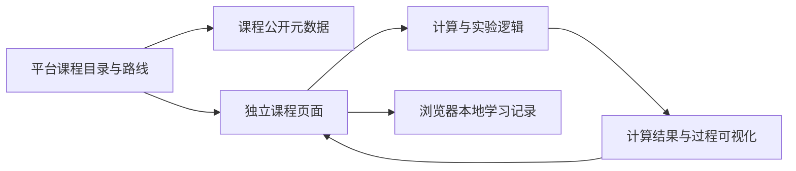

# 课程模块技术架构指南

本文面向准备开发下一个课程模块的开发者与开发 agent，依据 Transformer、Agent Lab、密码学和 FFT 四个现有项目的源码与配置总结工程经验。核对日期：2026-10-26。

目标是让每门课能独立开发、运行和验证，同时具备接入统一学习平台的条件。本文是公开工程指南，不是已发布的平台 API 规格，也不表示参考项目的测试已在本次文档工作中通过。

## 1. 先识别约束与建议

| 层次 | 内容 | 开发时如何处理 |
|---|---|---|
| 已确认约束 | 公开访问、免登录；用户进度在本地；主站提供公共学习路线；课程通过 submodule 管理；主仓库 MIT；AI 内容声明 | 新模块设计必须符合；独立仓库许可需明确，不能由主仓库自动覆盖 |
| 推荐基线 | 独立静态前端、计算与呈现分离、统一章节目录、分层验证、版本化发布 | 优先采用；偏离时说明具体需求、成本及验证方法 |
| 尚未定稿 | 平台入口框架、最终域名、课程 manifest 与进度 schema、路线 API 路径、共享 SDK、统一发布工具 | 不调用不存在的接口，不声称已完成平台接入 |

开始前先读目标仓库的 AGENTS.md、README、依赖清单和现有测试。已有课程沿用自身工具链；新课程先写清目标读者、先修知识、学习结果、代表性实验和部署约束，再选依赖。未知的产品决策应向维护者确认。

## 2. 平台、课程和仓库的边界

平台负责课程发现、跨课程学习路线与继续学习入口；课程负责章节、实验、练习和自身导航。课程事实由课程维护，跨课程编排由平台维护。



- 每个课程保留自己的依赖清单、锁文件、测试和构建产物。主仓库通过 submodule 固定课程提交，不等于把课程放进一个共享依赖的 workspace。
- 不从父仓库或相邻课程的源码相对路径 import 实现。需要共享时，先验证确有重复，再选择独立版本的包或数据协议。
- 发布优先组装独立静态产物，用正常页面导航连接课程。无需为几门课预先引入运行时微前端、远程 React 组件加载或共享全局 store。
- 课程无需账号服务、学习进度后端或服务端数据库。公开内容配置与用户记录分开，不能把“服务端不存用户数据”误解为不能发布课程目录。
- 模块开发与平台发布分开验收；单个课程的失败不应产生半套新版本产物。

## 3. 技术栈怎么选

四个参考项目都采用 React、TypeScript、Vite 和 pnpm，但版本并不相同：Transformer、密码学、FFT 的 manifest 是 React 18 / Vite 5 / TypeScript 5 系列，Agent Lab 是 React 19 / Vite 8 / TypeScript 6 系列。这是检查时的事实，不是新课程应照抄的版本清单。

| 能力 | 新课程推荐 | 选择边界 |
|---|---|---|
| 应用与构建 | React + TypeScript strict + Vite | 适合交互实验；若主要是阅读内容，可评估 Astro + React；不要因此迁移旧课程 |
| 路由 | 与 React 版本兼容的 React Router | 现有仓库同时存在 react-router-dom 与 react-router 两种用法，不能混抄不同代 API |
| 样式 | CSS 或 Tailwind，统一课程内排版与概念配色 | 选择一套适合课程的组件方案，不同时引入多套 UI 库 |
| 状态 | 局部状态优先，跨页面状态再引入轻量 store | Zustand 和轻量订阅实现均有实例；状态库不是接入协议 |
| 数学与可视化 | 按需使用 KaTeX、SVG、Canvas | 小型可交互图优先 SVG；密集绘图按测量选 Canvas，不默认上大型图表库 |
| 验证 | Vitest；交互用组件测试；关键浏览器能力用 Playwright 等 E2E 工具 | SSR 冒烟、快照和 E2E 覆盖不同问题，不能互相替代 |
| 依赖管理 | pnpm、提交锁文件、记录 packageManager 和 Node 约束 | 初始化时核对所选工具的官方兼容要求，不把参考仓库版本当作最新版本 |

共享的是数据边界和质量要求，课程可以使用适合主题的视觉表达。先实现一个可验证的小实验，再决定是否需要状态库、Worker 或额外 UI 依赖。

## 4. 目录与依赖方向

下面是推荐布局，只有需要时才创建相应目录；它不是必须一次生成的脚手架：

```text
src/
  main.tsx                 # 挂载与应用启动
  routes.tsx               # 路由组装
  base-url.ts              # 挂载前缀读取
  site-chapters.ts         # 学习单元的稳定 ID、路径和顺序
  chapters/<unit-id>/      # 章节编排、实验交互与本章测试
  components/              # 本课程确有复用的布局、控件和可视化
  lib/                     # 不依赖 React 的算法、状态机与数据变换
  content/                 # 长文、参考资料、固定教学数据
  i18n/                    # 仅在需要多语言时建立
  store/                   # 仅放跨页面状态及持久化适配
  workers/                 # 仅在计算量或执行隔离需求出现时建立
tests/                     # 跨模块与数据一致性验证
scripts/                   # 构建校验、来源检查、内容生成
public/                    # 需要保留固定名称的静态资源
docs/                      # 使用说明、架构决策和内容来源说明
```

依赖方向以“章节界面调用计算逻辑”为主：`lib` 不依赖 React、路由或 localStorage；存储适配层不负责教学计算；章节负责把解释、输入、结果和操作放在一起。只在一个实验里使用的组件留在章节目录，不提前抽成全站库。

## 5. 让演示与真实计算对应

每个实验先明确输入、输出、中间状态和失败条件，再实现界面。动画应消费计算过程返回的 trace 或状态快照，避免一套逻辑负责算答案、另一套硬编码数字负责演示。

- Transformer 的前向传播实现可返回注意力图和中间缓存，说明公式、计算与可视化可以共用计算结果。
- FFT 用同一组信号串起 DFT、FFT 与逆变换，并以朴素 DFT 交叉比对 FFT；适合推广为“贯穿章节的固定样例”。
- 密码学课程既验证算法，也验证交互组件实际接入计算结果。单元测试全部通过，仍可能出现界面显示写死结果的问题。
- Agent Lab 使用固定轨迹、故障输入和验收规范组织实验，默认演示可复现；外部模型调用不是读懂课程的前提。

建议记录随机种子、输入规模、浮点容差和模型或 fixture 版本。教学简化必须写出范围；示意动画标明“示意”，真实算法演示则验证结果来源。计算复杂度推导与机器计时结果分开解释。

展示源码时，从实际实现生成展示内容；Transformer 与 FFT 已有 `gen:source` 脚本。修改实现后要验证展示文本同步，不维护两份看起来相同的算法。

固定模型权重或 fixture 若已被叙事和测试依赖，应作为版本化资产维护。不要为了修复资源加载失败而重新训练模型或替换预期结果。

## 6. 章节、内容与来源只维护一份

课程需要一份章节登记，供导航、路由、进度和目录导出使用。至少表达稳定单元 ID、展示标题、路由路径、内容状态和顺序；预计时长、前置知识、引用来源与可用语言按需补充。

单元 ID 不随标题翻译或章节排序改变。附录、故事线和实验可以有不同入口，不能用数组下标作为持久化身份。区分硬性前置知识与推荐阅读顺序，构建时检查重复 ID、缺失页面和不存在的依赖。

现有项目的 `site-chapters.ts` 是可参考的目录入口；Agent Lab 的长文阅读目录与交互站点另有显式映射，说明“一站对应多章”不应被硬塞成同一套序号。

短说明可与组件共置；长文适合独立 Markdown 或内容文件。采用双语时，将可翻译文案与结构 ID 分开，并验证字典结构、叶子类型和必填字段。数值是否随语言改变需按语义判断，例如词序改变可能同时改变注意力示例的索引。

关键公式、数字与结论应附可定位的原始来源。建议来源记录包含：标题、作者或机构、URL 或 DOI、文档版本或发布日期、章节或页码、支持的具体结论、核验状态，以及素材许可。链接能打开只说明可访问，不说明它支持该结论。

遵循 [AI 创作与内容声明](ai-content-disclosure.md)：教程由 AI 基于公开文档和论文创作，不保证完全准确；未核实的来源不能伪装成已经核实的事实。声明要出现在课程 README 和读者可找到的页面入口。

## 7. 路由、资源与部署要一起验证

三个参考课程已经使用 `/study/<course-id>/` 子路径，FFT 当前仍按根路径运行。该前缀是现有部署约定，新平台最终前缀尚未确认；不要写死具体域名，也不要把旧主站协议直接视为新平台协议。

新模块应明确四件事：构建时的 Vite `base`、客户端 Router 的 `basename`、运行时资源 URL 的生成方式、部署服务器的深链接回落规则。四者必须一致。Vite 会调整它处理的资源路径，动态拼接的 URL 仍需正确使用配置前缀。[Vite 构建文档](https://vite.dev/guide/build.html#public-base-path)

- 前缀集中读取；不要在页面中散落根路径 `/assets/`、`/models/` 或父站域名。
- 若源码还会由 tsx 或 SSR 检查脚本直接加载，要处理 Vite 环境不存在的情况。参考课程的 `base-url.ts` 为此提供回退；运行期回退不能替代生产前缀校验。
- 站内跳转成功还不够，必须直接打开并刷新一个深层章节 URL。未知章节应显示可恢复的 404。
- 尾斜杠和独立 HTML 入口按真实托管规则验证。Transformer 的故事线是多页构建入口，复制 SPA 路由配置不能保留它的分享页面行为。
- 服务器回落应区分页面路径与缺失静态资源，避免资源 404 被错误替换成 HTML。

普通导入资源可随构建生成带哈希的文件；`public` 中的文件按原名称复制，不自动获得同样的版本化方式。[Vite 资源文档](https://vite.dev/guide/assets.html#the-public-directory)

经常更新的教学数据优先进入构建资源图。必须保留固定路径的大模型文件或媒体，应制定版本化文件名或缓存更新规则，不能只覆盖同名文件后假定所有读者都会立刻拿到新内容。历史课程已放在 public 的权重不必为统一目录而迁移，先解决版本与路径正确性。

## 8. 学习进度保存在本地

现有课程的存储格式不同：部分用 Zustand persist 保存 visited/done，Agent Lab 使用独立 key 保存已完成站点。它们是现有实现，不是未来平台共享进度 schema。

新模块推荐把持久化集中在独立适配层，满足：

- key 使用稳定课程 ID 作为命名空间，不能使用会改名的展示标题。
- 区分已访问、用户手动完成、练习验收通过；记录结果对应的内容版本。
- 明确序列化格式版本、迁移规则和未知字段处理；迁移前保留可恢复的旧记录。
- 处理解析失败、存储被禁用或容量不足，向用户说明保存失败，继续允许阅读。
- 支持导出、导入和清除；导入需检查格式、大小与课程身份，多标签冲突应有可验证的规则。
- 临时播放位置、悬浮态和大型中间计算结果不默认持久化。

小型进度可用 localStorage，较大草稿或结构化记录可评估 IndexedDB，平台尚未统一选型。localStorage 按 origin 划分；相同域名的不同子路径不是存储安全隔离，更换域名也不会自动迁移记录。[MDN localStorage](https://developer.mozilla.org/en-US/docs/Web/API/Window/localStorage)

同源部署便于共享协议，但 key 前缀只能避免命名冲突，不能阻止同源代码读取别的 key。不要在通用进度对象中存 API key，也不要把学习数据传给平台服务端。远端课程目录暂不可用时，已加载课程应仍可继续使用本地进度。

## 9. 浏览器能力、性能与执行边界

先测量再拆包。密码学课程有章节懒加载，Agent Lab 预载站页但分离阅读渲染器等重依赖；二者服务的内容与导航方式不同。新模块应检查入口包、单章加载和切换体验，再决定按章节还是按实验拆分。

- 编辑器、长文渲染器和大媒体按需加载；不要让访问首页触发所有实验初始化。
- 长计算按实际耗时选择 Worker 或分步调度；支持停止、重置和卸载清理，避免更新已离开的页面。
- 动画需能暂停，支持减少动态效果；拖动和颜色编码提供键盘操作、文本或数值替代。
- 麦克风等权限由用户操作触发，提供拒绝、无设备和不支持时的替代体验；停止实验后释放资源。
- 普通阅读不应依赖模型账号或外部密钥。需要外部模型的实验默认提供回放或固定样例；启用真实调用前说明会发送什么数据，密钥不进入仓库或日志。

执行读者提供的代码时，Worker 的超时终止只解决主线程阻塞的一部分问题。Worker 仍可使用网络和部分存储 API，不能被当作完整的安全沙箱。[MDN Worker](https://developer.mozilla.org/en-US/docs/Web/API/Web_Workers_API/Using_web_workers)

应先确认信任模型，再选择隔离 origin、受限沙箱或受限解释器等方案，并验证消息来源、输入结构、网络能力与资源上限。平台尚未提供统一执行沙箱，不得声称已有安全运行任意代码的能力。Markdown 或导入数据也应限制可执行内容，不直接信任用户提供的 HTML。

## 10. 验证要覆盖从算法到产物的过程

| 层次 | 检查什么 | 经验与边界 |
|---|---|---|
| 算法与状态机 | 已知答案、边界输入、不变量、随机种子、误差范围 | FFT 对比朴素 DFT；逆变换往返测试还需独立答案，避免两个错误互相抵消 |
| 页面交互 | 改输入后输出真的变化，重置生效，错误可见 | 密码学案例表明仅测试函数不足；优先行为测试，不机械复制源码字符串断言 |
| 元数据与内容 | ID 唯一、路由与目录对应、前置引用有效、语言结构一致、来源可定位 | “内容 ready”应对应实际页面和实验，不由陈旧 README 决定 |
| SSR 冒烟或快照 | 所有路由能渲染，关键正文与小节存在 | 空布局也可能有很多 HTML；检查关键小节，不能只看非空；不等于生产采用 SSR |
| 浏览器 E2E | 深链接刷新、设备权限、Worker、存储异常、主要交互 | FFT 已有麦克风用例；SSR 的浏览器垫片不能证明真实设备能力可用 |
| 构建产物 | 静态文件存在、资源前缀、元数据、重依赖拆包、未知路径行为 | Agent Lab 的 check:dist 提供参考，但其固定 chunk 名与旧主站规则不是通用契约 |

新课程建议定义并实际接通 `lint`、`test`、`build`；按需要增加 `smoke`、`e2e`、`check:dist`、`gen:source` 和来源核对。命令须存在于目标仓库的 package.json，相关工具须已声明为依赖，之后才能写入完成门槛。

参考仓库的已存在命令（本次仅检查定义，没有执行）：

| 课程 | 基础命令 | 额外检查 |
|---|---|---|
| Transformer | test、build | smoke、snap:check、facts:check；没有 lint script |
| Agent Lab | lint、test、build | check:dist、snap:check；build 已调用 check:dist |
| 密码学 | lint、test、build | smoke |
| FFT | test、build | smoke、e2e、links:check；没有 lint script |

验收应记录运行命令、结果与未覆盖部分。不能把快照更新当作错误修复，也不能因为免责声明存在而省略正确性验证。

## 11. 接入与发布准备

课程对外需要能够描述：稳定课程 ID、入口路径、语言、内容状态、学习单元及版本、支持的能力和构建产物。这里列的是信息需求，不是已经定稿的 JSON 字段。

现有三个课程提供 `public/metadata.json`，采用旧主站的 `schema: 1` 格式；FFT 尚无该文件。它不是新平台的完整课程或进度协议。兼容旧主站时按其实际 schema 校验，面向新平台时先与维护者确认契约，不能自行扩展字段后假定平台会读取。

新平台的公共学习路线拟以静态 JSON 发布，但 URL、schema 和客户端 SDK 尚未实现。新课程可先独立运行并维护自身目录，不应依赖虚构的平台 npm 包或网络端点。

接入 submodule 时，先保证固定提交可从远端获取，再更新主仓库引用；生产发布不能浮动跟随课程分支。为整套发布记录课程提交与产物版本，保留可回退的上一版本。Git 写操作仍需遵循目标仓库的授权约定。

分发产物保留课程及第三方材料的许可、版权和署名信息；主仓库 MIT 不会重新许可已有子仓库。公共文档使用可公开的资料；总结未公开仓库时只披露获准公开的设计经验，不包含本机绝对路径、凭据或内部过程记录。

## 12. 新课程开发 agent 的执行顺序

1. **确定教学目标**：列出读者前提、代表性实验、需解释的机制与验收结果。检查是否已有类似模块，记录原始资料。
2. **确定最小架构**：说明技术栈、稳定 ID、挂载路径、计算与呈现边界、存储需求，以及与本指南不同的选择。平台未定事项先确认。
3. **实现一章端到端样例**：先给计算逻辑建立独立验证，再接交互、正文、路由和进度。以真实子路径打开并刷新，检查读者能完成实验。
4. **再扩充内容**：沿用目录、引用与实验结构，按真实重复提取组件；同步展示源码、语言字典和测试，不一次生成全部空目录。
5. **验证发布产物**：运行实际存在的检查，验证深链接、资源、模型、存储失败、权限拒绝和退出清理；列清未覆盖项。
6. **交付接入资料**：在课程 README 或公开文档记录下表内容，交由主仓库按固定版本接入。没有执行的接入、测试或发布不得写成完成。

| 交付项 | 必须说清的内容 |
|---|---|
| 教学与来源 | 目标读者、学习结果、资料与核验状态、AI 声明、教学简化 |
| 工程 | 依赖与运行环境、实际命令、目录职责、架构取舍 |
| 接入 | 课程 ID、入口与 base、目录来源、状态、协议待定项 |
| 本地数据 | key 或数据库命名空间、格式版本、迁移及导入导出行为 |
| 发布 | 固定提交、构建产物、路由回落要求、许可与署名文件 |
| 验证 | 已运行命令和结果、浏览器检查、已知限制及未覆盖场景 |

## 13. 本次经验的源码定位

以下版本是核对时的本地 Git 提交，文件路径相对于各参考仓库根目录。参考源码未必可匿名取得，因此本文已经写出可独立使用的结论，不要求读者能够访问这些仓库。

| 参考项目与提交 | 核对文件 | 支持的经验 |
|---|---|---|
| Transformer · `864615d` | `src/lib/minigpt/gpt.ts`、`scripts/gen-gpt-source.ts`、`tests/story-model.test.ts` | 计算过程可视化、展示源码生成、叙事与固定模型行为一致 |
| Transformer · `864615d` | `vite.config.ts`、`src/base-url.ts`、`tests/i18n.test.ts` | 多页入口、前缀读取、语言结构检查 |
| Agent Lab · `927ce23` | `src/routes.ts`、`src/site-chapters.ts`、`src/content/book/manifest.ts` | 站点登记与路由、阅读章节与交互站的显式映射 |
| Agent Lab · `927ce23` | `src/lib/progress.ts`、`src/lib/acceptance/sandbox.ts`、`scripts/check-dist.mjs` | 轻量本地进度、Worker 超时生命周期、产物校验 |
| 密码学 · `19f5fab` | `src/chapters/registry.ts`、`src/store/progress.ts`、`tests/chapter8.test.ts` | 章节懒加载、本地状态、函数验证与页面接线验证 |
| FFT · `fcd2168` | `tests/fft.test.ts`、`scripts/gen-fft-source.ts`、`scripts/ssr-smoke.tsx`、`e2e/mic.spec.ts` | 独立算法比对、源码同步、关键正文检查、设备 E2E |

上述经验应随接入实践更新。当前主仓库仍只有治理与文档；本文不代表已建立共享运行时、统一进度存储或课程发布服务。
